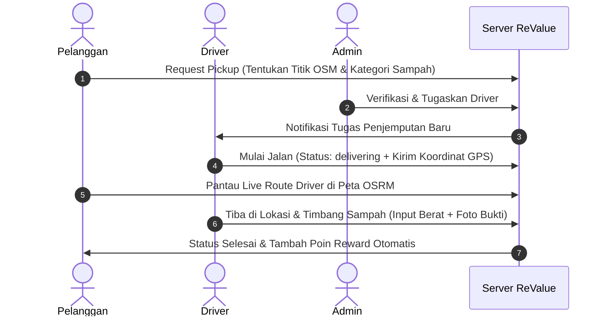
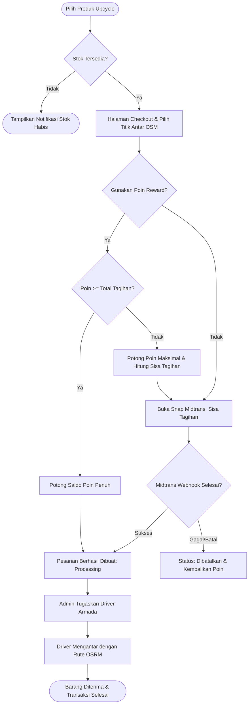

# ReValue: Ekosistem Bank Sampah Digital Berbasis Circular Economy dengan Integrasi Geolocation dan Subscription Payment

<p align="center">
  
</p>

<p align="center">
  <strong>Solusi Pengelolaan Sampah Terintegrasi, Pemberdayaan Masyarakat, dan Akselerasi Ekonomi Sirkular Masa Depan.</strong>
</p>

<p align="center">
  <a href="#-gambaran-umum"></a>
  <a href="#-arsitektur--teknologi"></a>
  <a href="#-arsitektur--teknologi"></a>
  <a href="#-arsitektur--teknologi"></a>
  <a href="#-arsitektur--teknologi"></a>
  <a href="#-arsitektur--teknologi"></a>
  <a href="#-arsitektur--teknologi"></a>
</p>

---

## 📑 Daftar Isi

1. [Latar Belakang & Masalah](#-latar-belakang--masalah)
2. [Solusi ReValue: The Closed-Loop Circular Ecosystem](#-solusi-revalue-the-closed-loop-circular-ecosystem)
3. [Fitur Unggulan](#-fitur-unggulan)
4. [Arsitektur Sistem & Alur Bisnis](#-arsitektur-sistem--alur-bisnis)
5. [Inovasi Rekayasa Perangkat Lunak](#-inovasi-rekayasa-perangkat-lunak)
6. [Teknologi yang Digunakan (Tech Stack)](#-teknologi-yang-digunakan-tech-stack)
7. [Desain Sistem & Filosofi UI/UX](#-desain-sistem--filosofi-uiux)
8. [Panduan Instalasi & Menjalankan Proyek](#-panduan-instalasi--menjalankan-proyek)
9. [Automated Testing & Kualitas Kode](#-automated-testing--kualitas-kode)
10. [Pipeline CI/CD & Deployment Produksi](#-pipeline-cicd--deployment-produksi)
11. [Dampak Sosial & Penyelarasan SDGs](#-dampak-sosial--penyelarasan-sdgs)

---

## 🌍 Latar Belakang & Masalah

Timbulan sampah perkotaan terus mengalami lonjakan eksponensial di mana **lebih dari 60% sampah berakhir menumpuk di Tempat Pemrosesan Akhir (TPA)** tanpa pemilahan yang terstruktur. Model bank sampah konvensional selama ini terhambat oleh berbagai tantangan mendasar:

1. **Inefisiensi Logistik**: Penjemputan sampah tidak terpetakan secara digital, rute armada manual, dan tingginya biaya transportasi.
2. **Ketiadaan Insentif Langsung & Berkelanjutan**: Rendahnya partisipasi masyarakat karena insentif pemilahan sampah tidak langsung dapat dibelanjakan atau dimanfaatkan.
3. **Model Bisnis yang Rentan**: Bank sampah kesulitan menutupi biaya operasional penjemputan rutin door-to-door.
4. **Ketergantungan Ekosistem Tertutup**: Produk hasil olahan daur ulang (upcycle) jarang memiliki etalase digital yang terintegrasi langsung dengan para nasabah pemilah sampah.

---

## 💡 Solusi ReValue: The Closed-Loop Circular Ecosystem

**ReValue** merevolusi tata kelola bank sampah modern melalui pendekatan **Closed-Loop Circular Economy** yang menggabungkan:

- **Subscription-based Logistics**: Warga berlangganan kuota penjemputan sampah rutin terjadwal (_Subscription Payment via Midtrans_), menjamin _sustainable operational revenue_.
- **Open-Source Geospatial Logistics**: Titik penjemputan dan pengantaran terintegrasi peta interaktif (_OpenStreetMap_), rute optimal (_OSRM_), serta _live GPS tracking_ armada kurir tanpa biaya API mahal dari vendor pihak ketiga.
- **Upcycle Market & Hybrid Currency**: Poin dari setoran sampah dapat digunakan langsung untuk berbelanja produk upcycle berkualitas, dengan mekanisme pembayaran hibrida (Poin + Rupiah Midtrans).
- **Multi-Stakeholder Collaboration**: Menghubungkan secara mulus 4 entitas: **Pelanggan**, **Driver Armada**, **Admin Pengelola**, dan **Publik**.

```
  [Warga/Pelanggan]  ──── Setor Sampah Terpilah ───►  [Bank Sampah / Admin]
         ▲                                                     │
         │ (Tukar Poin / Belanja)                       (Olah Sampah)
         ▼                                                     ▼
  [Upcycle Store]    ◄─── Produk Daur Ulang ────────  [Produksi Upcycle]
         ▲
         │
  [Armada Driver] (Penjemputan & Pengantaran Real-Time OSRM)
```

---

## 🚀 Fitur Unggulan

### 1. Peran Pelanggan (Customer / Warga)

- **Peta Interaktif Penjemputan (`LocationPicker`)**: Drag-and-drop marker peta OpenStreetMap (CartoDB Positron), tombol geolokasi GPS otomatis, dan reverse geocoding alamat otomatis.
- **Manajemen Langganan (Subscription Membership)**: Integrasi Midtrans Snap untuk aktivasi member penjemputan sampah bulanan dengan ragam metode pembayaran (QRIS, Virtual Account, Kartu Kredit, GoPay).
- **Upcycle Store Terintegrasi**: Katalog produk kerajinan daur ulang dengan opsi pembayaran fleksibel:
    - _Poin Penuh_: Potong poin sampah tanpa perlu uang tunai jika saldo poin mencukupi.
    - _Hybrid Payment_: Poin memotong harga produk secara instan, sisa tagihan dibayar via Midtrans Snap.
- **Pelacakan Armada Kurir Real-Time**: Visualisasi live pergerakan driver dan rute penjemputan/pengantaran berbasis OSRM saat pesanan berstatus `delivering`.
- **Riwayat & Evaluasi Setoran**: Tracking berat sampah terpilah (Plastik, Kertas, Logam, Kaca, Organik) dan audit log penerimaan koin reward.

### 2. Peran Driver (Armada Lapangan)

- **Manajemen Tugas Penjemputan & Pengantaran**: Antarmuka mobile-friendly untuk daftar tugas harian pengangkutan sampah dan distribusi produk daur ulang.
- **Turn-by-Turn OSRM Routing Engine**: Panduan rute jalan raya dari titik armada menuju alamat warga dengan kalkulasi jarak (km) dan estimasi waktu tempuh.
- **Pelacakan Lokasi Otomatis (`useDriverLocation`)**: Sinkronisasi koordinat GPS driver ke server secara berkala saat pengantaran aktif (threshold pergerakan $\ge 30$ m atau heartbeat 60 detik).
- **Verifikasi Bukti Lapangan**: Unggah dokumentasi foto bukti serah terima sampah/barang langsung dari kamera perangkat lapangan.

### 3. Peran Administrator (Pengelola Bank Sampah)

- **Dashboard Analitik Eksekutif**: Metrik pendapatan langganan, volume timbulan sampah per kategori, total nasabah aktif, dan rasio daur ulang.
- **Dispatch & Manajemen Kurir**: Penugasan armada kurir untuk penjemputan sampah maupun pengiriman transaksi produk upcycle.
- **Katalog & Kategori Daur Ulang**: Manajemen dinamis kategori sampah, nilai tukar poin per kilogram, dan inventaris produk daur ulang.
- **Edukasi Lingkungan & Manajemen Artikel**: CMS publikasi artikel tips gaya hidup ramah lingkungan didukung Rich Text Editor modern (TipTap).
- **Audit Transaksi Finansial**: Rekapitulasi transaksi Midtrans, status webhook, rekonsiliasi manual, dan status pembayaran.

### 4. Halaman Publik & Edukasi Warga

- **Peta Jangkauan Layanan (Coverage Area)**: Visualisasi radius layanan operasional bank sampah.
- **Kalkulator Simulasi Sampah**: Perhitungan estimasi koin reward berdasarkan jenis dan perkiraan berat sampah.
- **Desain Tactile 3D (Duolingo Style)**: Estetika visual yang ceria, tombol 3D taktil, kartu bayangan tebal, dan tipografi ramah keluarga yang meningkatkan retensi pengguna.

---

## 🏗 Arsitektur Sistem & Alur Bisnis

### A. Alur Penjemputan Sampah & Daur Ulang (Pickup Lifecycle)



### B. Alur Transaksi Toko Daur Ulang & Pembayaran Hibrida



---

## ⚡ Inovasi Rekayasa Perangkat Lunak

1. **Zero Vendor-Lock Geospatial Infrastructure**:
   Alih-alih menggunakan Google Maps Platform berbayar, ReValue mengimplementasikan:
    - **CartoDB Positron Basemap Tile Layer**: Performa rendering peta yang ringan dan estetika minimalis elegan.
    - **Self-Hosted / Proxy OSRM Routing**: Menghitung rute tercepat dan koordinat polyline jalan raya secara dinamis tanpa biaya API per request.
    - **Nominatim Reverse Geocoding**: Mengonversi titik koordinat marker menjadi nama jalan dan kecamatan secara instan.
2. **Robust Payment & Webhook Reconciliation**:
    - Sistem webhook Midtrans yang tangguh dilengkapi fitur _Signature Key Verification_, penanganan idempotensi transaksi, dan tombol _Cek Status Pembayaran Manual_ untuk mengantisipasi kegagalan jaringan eksternal.
3. **Optimasi Arsitektur Service Layer**:
    - Seluruh logika bisnis dipisahkan ke dalam _Dedicated Service Classes_ (`app/Services/`), menjamin _Single Responsibility Principle (SRP)_, kemudahan pengujian unit, dan kebersihan controller.
4. **Keamanan & Standar Ketat PHPStan Level 7**:
    - Seluruh codebase backend telah diaudit menggunakan Larastan pada **Level 7**, memastikan integritas pengetikan data (_type safety_) dan pencegahan potensi bug di lingkungan produksi.

---

## 🛠 Teknologi yang Digunakan (Tech Stack)

| Kategori                 | Teknologi                        | Deskripsi                                                                            |
| ------------------------ | -------------------------------- | ------------------------------------------------------------------------------------ |
| **Backend Framework**    | **Laravel 11.x (PHP 8.3)**       | Arsitektur MVC modern dengan Service Layer, Eloquent ORM, dan Enums PHP 8.3          |
| **Frontend Reactive**    | **Vue.js 3.5 (Composition API)** | Reactive UI modern dengan `<script setup lang="ts">`                                 |
| **Monolith Bridge**      | **Inertia.js v2**                | Routing SPA super cepat tanpa overhead pembuatan REST API terpisah                   |
| **Type Safety**          | **TypeScript 5.2**               | Pengetikan statis penuh untuk stabilitas komponen frontend                           |
| **Styling & Design**     | **Tailwind CSS v4**              | Utility-first CSS dengan custom tactile-3d duolingo style palette                    |
| **Geospatial & Mapping** | **Leaflet.js + OSRM + OSM**      | Peta open-source, reverse geocoding, dan perutean mengemudi OSRM                     |
| **Payment Gateway**      | **Midtrans Snap Engine**         | Integrasi multi-metode pembayaran (QRIS, E-Wallet, VA, Card)                         |
| **Rich Text Editor**     | **TipTap Editor**                | Editor artikel interaktif berbasis headless DOM                                      |
| **Database**             | **MySQL 8.0**                    | Relational Database Management System dengan index spasial dan integritas relasional |
| **Containerization**     | **Docker & Docker Compose**      | Multi-stage image build (PHP 8.3-FPM Alpine + Nginx + Supervisord)                   |
| **CI / CD Pipeline**     | **GitHub Actions**               | Linting otomatis, PHPStan, Pest testing, Docker GHCR Push, dan SSH Deployment        |

---

## 🎨 Desain Sistem & Filosofi UI/UX

Aplikasi ReValue mengadopsi estetika **Duolingo-inspired 3D Tactile Design System**:

- **Sensasi Taktil Nyata**: Komponen tombol dan kartu dilengkapi border bawah tebal (`border-b-4`), transisi halus (`active:translate-y-1 active:border-b-0`), memberikan respon klik yang memuaskan (_satisfying feedback_).
- **Palet Warna Segar & Berenergi**:
    - `Emerald & Mint Green`: Merepresentasikan keberlanjutan, daur ulang, dan alam.
    - `Amber & Golden Yellow`: Menandai reward poin, koin tabungan, dan kehangatan komunitas.
    - `Sky Blue & Indigo`: Menandakan keandalan armada logistik dan akurasi geospasial.
- **Aksesibilitas & Keterbacaan**: Kontras rasio tinggi, tipografi Nunito yang ramah (_rounded Sans-Serif_), serta layout adaptif responsif (_mobile-first_).

---

## 💻 Panduan Instalasi & Menjalankan Proyek

### Prasyarat

- PHP $\ge$ 8.3 (dengan ekstensi `pdo_mysql`, `mbstring`, `bcmath`, `curl`, `zip`)
- Composer 2.x
- Node.js $\ge$ 22.x & npm
- MySQL Server $\ge$ 8.0

### Langkah Instalasi Lokal

1. **Clone Repositori**:

    ```bash
    git clone https://github.com/tunggulalmajid/TechnoVesary-Vol-2.git
    cd TechnoVesary-Vol-2
    ```

2. **Pasang Dependensi Backend & Frontend**:

    ```bash
    composer install
    npm install
    ```

3. **Konfigurasi Environment**:

    ```bash
    cp .env.example .env
    php artisan key:generate
    ```

    _Buka file `.env` dan sesuaikan kredensial database MySQL Anda:_

    ```dotenv
    DB_CONNECTION=mysql
    DB_HOST=127.0.0.1
    DB_PORT=3306
    DB_DATABASE=revalue_db
    DB_USERNAME=root
    DB_PASSWORD=
    ```

4. **Migrasi & Seeder Database**:

    ```bash
    php artisan migrate:fresh --seed
    ```

    _Seeder akan membuat akun demo untuk setiap peran:_
    - **Admin**: `admin@banksampah.test` | Password: `password`
    - **Driver**: `driver@banksampah.test` | Password: `password`
    - **Customer**: `customer@banksampah.test` | Password: `password`

5. **Jalankan Aplikasi Development**:
    ```bash
    # Jalankan server Laravel dan Vite secara bersamaan
    npm run dev
    # Di terminal terpisah:
    php artisan serve
    ```
    Akses aplikasi di: **`http://localhost:8000`**.

---

## 🧪 Automated Testing & Kualitas Kode

ReValue dibangun dengan disiplin rekayasa perangkat lunak yang ketat untuk menjamin stabilitas dan keandalan sistem:

```bash
# 1. Type-Checking Frontend (TypeScript & Vue SFC)
npm run types:check

# 2. Linter & Formatting Frontend
npm run check

# 3. Code Style Checker Backend (Laravel Pint)
vendor/bin/pint --test

# 4. Analisis Statis PHPStan (Level 7)
vendor/bin/phpstan analyse

# 5. Menjalankan Seluruh Automated Test Suite (Pest / PHPUnit)
php artisan test
```

---

## 🚀 Pipeline CI/CD & Deployment Produksi

Aplikasi ini siap digunakan di lingkungan produksi nyata menggunakan pipeline **Continuous Integration / Continuous Deployment (CI/CD)** berbasis GitHub Actions dan Docker:

```
[ Developer Push ke Main ]
            │
            ├──► [ GitHub Actions: CI ]
            │       ├── PHPUnit / Pest Test Suite
            │       ├── PHPStan Static Analysis (Level 7)
            │       ├── Laravel Pint Style Checking
            │       └── Vue-TSC Type Checking & Asset Build
            │
            └──► [ GitHub Actions: Deploy ]
                    ├── Build Multi-Stage Dockerfile (Alpine + PHP 8.3 FPM + Nginx)
                    ├── Push Image ke GitHub Packages (GHCR)
                    └── SSH ke VPS Ubuntu -> Eksekusi deploy/deploy.sh
                            ├── Docker Compose Pull Image Terbaru
                            ├── Database Migration & Non-Destructive Seed
                            ├── Zero-Downtime Container Recreation
                            └── Automated Health Check (GET /up)
```

Panduan lengkap mengenai arsitektur server produksi, konfigurasi Nginx reverse proxy, dan setup sertifikat SSL Let's Encrypt dapat dipelajari di dokumen **[docs/DEPLOYMENT.md](docs/DEPLOYMENT.md)**.

---

## 🌿 Dampak Sosial & Penyelarasan SDGs

ReValue dirancang tidak sekadar sebagai perangkat lunak, melainkan sebagai katalisator pencapaian **Tujuan Pembangunan Berkelanjutan (Sustainable Development Goals / SDGs)**:

| SDG Indicator                                      | Kontribusi Nyata ReValue                                                                                                                                         |
| -------------------------------------------------- | ---------------------------------------------------------------------------------------------------------------------------------------------------------------- |
| **SDG 11: Sustainable Cities and Communities**     | Mengurangi beban timbulan sampah kota ke TPA melalui digitalisasi rute penjemputan terpilah langsung dari sumbernya (rumah tangga).                              |
| **SDG 12: Responsible Consumption and Production** | Mendorong daur ulang dan memperpanjang siklus hidup material melalui etalase produk upcycle yang bernilai jual ekonomis.                                         |
| **SDG 13: Climate Action**                         | Mereduksi emisi gas metana ($CH_4$) akibat pembusukan sampah organik tak terkelola melalui pemilahan terintegrasi dan efisiensi rute armada bahan bakar minimum. |
| **SDG 8: Decent Work and Economic Growth**         | Membuka lapangan kerja ramah lingkungan (_green jobs_) bagi para pengemudi armada dan pengrajin lokal daur ulang sampah.                                         |

---

<p align="center">
  Dibuat dengan dedikasi untuk masa depan bumi yang lebih hijau dan lestari. 🍃<br>
  <strong>ReValue Team &copy; 2026. All rights reserved.</strong>
</p>
